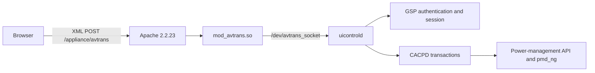

# PM3000 Modern Web UI and REST Analysis

## Scope

This analysis targets Avocent PM3000 firmware `2.0.1.23`. It is based on:

- the original Web UI and selected backend files extracted from the firmware;
- the existing compatibility repair under [`../fix-WebUI/`](../fix-WebUI/);
- the supplied repair handover and architecture notes;
- static ELF/configuration inspection only.

No firmware binary was executed and no PM3000 was contacted or modified.

The supplied ZIP was inspected before extraction. It contained 330 regular files, no traversal paths, symlinks, or encrypted entries. Its embedded manifest verified 329 of 329 payload files. The extracted vendor files are analysis inputs only and must not be committed or redistributed without a separate license review.

## Confirmed legacy architecture

### Browser protocol

The original browser application is an XML/XSLT application:

- `index.xml` loads `transformation.xsl`.
- `XML_request()` in `scripts-20150511.js` creates an `<avtrans>` document.
- `load_XML()` sends the XML body to `/appliance/avtrans` with the historical content type `application/x-www-form-urlencoded`.
- Requests contain `sid`, `action`, fixed agents `wmi -> controller`, one or more paths, and an optional payload.
- Responses are XML and include at least an action, path, session identifier, and payload.
- The legacy client transforms responses with XSLT and then performs fragile string and DOM processing.

The new client must preserve the proven request format until a captured request/response contract demonstrates that a change is safe. It must build XML structurally and escape all values; it must never concatenate caller-controlled backend paths or action names.

### Server path

Static analysis confirms:

- Apache maps `/appliance/avtrans` to `mod_avtrans.so`.
- `mod_avtrans.so` forwards requests to `/dev/avtrans_socket` and receives replies from the UI controller.
- `/usr/sbin/uicontrold` parses XML, creates or resumes GSP sessions, connects to CACPD, submits transactions, commits or reverts changes, and emits the response XML.
- `uicontrold` uses the existing GSP authentication and authorization stack rather than bypassing it.
- CACPD exposes the management model over `/dev/cacpd` with `usercred` and `gspaaa` authentication.

The adapter must use the existing Avtrans/UI-controller path. Although the extracted files expose CACPD client libraries and a permissive Unix-socket endpoint, a new direct CACPD client would bypass the proven UI-controller translation/session layer and would require undocumented ABI and protocol assumptions. Direct calls to CACPD or `pmcommand`, or writes to vendor configuration files, are therefore out of scope.

### Power-control model

The readable feature-module configuration confirms these distinctions:

- outlet status is read through the existing management model;
- individual outlet actions include `on`, `off`, and `cycle`, while the backend also defines operations such as `lock`, `unlock`, `ion`, and `ioff`;
- PDU-wide actions are separate from individual outlet actions;
- the backend resolves logical identifiers to port, PDU, and outlet numbers;
- authorization is checked for the PDU and/or outlet before execution;
- unsupported operations can fail explicitly;
- destructive and unrelated operations such as firmware upgrade, factory default, PDU reboot, and configuration writes also exist in the same backend namespace.

Therefore the first REST release must expose only inventory/status and individual outlet `on|off|cycle`. It must not expose `lock`, `unlock`, `ion`, `ioff`, arbitrary paths, generic method dispatch, PDU-wide/global actions, firmware functions, factory reset, reboot, or configuration writes.

The original frontend does not hard-code the concrete power paths. It renders paths, action IDs, controls, dependencies, confirmation metadata, and current values supplied by the backend. Labels are presentation text, not protocol identifiers. A replacement must use captured structural identifiers and must never derive a request from a displayed label or guessed port/PDU/outlet arithmetic.

## Legacy UI footprint

The original Web root contains 102 files and occupies 2,056,933 bytes.

Largest components:

- obsolete Java terminal applet: 1,203,167 bytes;
- xWire bundle: 194,802 bytes;
- main JavaScript: 139,308 bytes;
- XSL stylesheet: 104,397 bytes;
- images and styles: approximately 205 KiB.

A dependency-free modern UI, inline or tightly bundled SVG icons, and a small native CGI adapter should fit below a provisional 400 KiB installed target. This target must be measured from the release archive and installed tree at every milestone. The observed free persistent space was about 2.3 MiB, but deployment must re-measure it.

## Recommended target architecture

### Keep Apache

Keep the vendor Apache and its modules. Apache already contains CGI support and includes `/etc/apache2/conf.d/`.

The preferred deployment is:

- static modern assets under `/mnt/hdUser/pm3000-revive/webui/releases/<release-id>/`;
- a `current` symlink switched only after verification;
- one small native PPC32 big-endian CGI adapter;
- one isolated `/etc/apache2/conf.d/pm3000-revive.conf` only if required for Alias/CGI routing and forwarding the standard Authorization header;
- the original `/` Web UI retained during the pilot, with the modern UI initially available at `/modern/`.

This avoids replacing Apache, avoids a second resident web server, minimizes flash writes, and keeps rollback narrow. Whether Apache 2.2 passes `Authorization` to CGI must be verified in a local contract test and then on the device. Do not assume it.

### REST facade

Initial API surface:

- `GET /api/v1/health`
- `GET /api/v1/outlets`
- `GET /api/v1/outlets/{stable-id}`
- `POST /api/v1/outlets/{stable-id}/actions` with an enum action of `on`, `off`, or `cycle`
- token administration endpoints available only to an `admin` token

The adapter must:

- reject unknown JSON members, methods, actions, identifiers, oversized bodies, duplicate keys, and malformed UTF-8;
- reject every API request that was not received through HTTPS;
- resolve a stable outlet ID only from a freshly obtained backend inventory;
- construct only predeclared Avtrans request templates;
- preserve backend authorization and return a fail-closed error when mapping, session state, or response interpretation is ambiguous;
- use bounded request, XML, JSON, and response sizes;
- serialize or otherwise protect state-changing operations;
- treat timeouts after dispatch as an unknown result and never retry `cycle` automatically;
- omit secrets, credentials, session IDs, and complete backend XML from logs.

### Vendor identity

Bearer tokens must not bypass the vendor authorization model. The recommended design uses a dedicated, least-privilege vendor account whose rights are limited to the intended outlets. Its credentials are stored separately from tokens with restrictive ownership and are never returned by the API.

If a suitable least-privilege account cannot be provisioned and verified, remote control remains blocked. A root or broad administrative account is not an acceptable default.

### Multiple bearer tokens

Support multiple opaque random tokens with:

- at least 256 bits of randomness;
- one-time display of the plaintext token;
- only a SHA-256 digest stored on the device;
- constant-time digest comparison;
- immutable token ID, human label, creation time, enabled state, scope, and optional outlet allowlist;
- scopes `read`, `control`, and `admin`;
- immediate revocation;
- no token in URLs, browser local storage, logs, or diagnostic output.

Token storage belongs under `/mnt/hdUser/pm3000-revive/rest/`, outside the Web root. Publication must be atomic and protected by a lock. Existing valid configuration must never be replaced by an empty or partially parsed file.

The first administrative token is a bootstrap secret created by the host-side deployment/provisioning command and shown once. Subsequent tokens can be created and revoked in the modern Web UI submenu. The token-management UI should request the administrative token for the current operation and keep it in memory only.

## Modern UI direction

The modern UI should retain recognizable functional groupings rather than visually copy the fragile XSL layout:

- status/dashboard;
- outlets and individual controls;
- appliance and network information;
- users/authorization where supported;
- tools and diagnostics;
- a dedicated **REST API tokens** submenu in the administration area.

Requirements:

- responsive layout using semantic HTML, modern CSS grid/flexbox, and plain bundled JavaScript;
- no runtime CDN, framework, package manager, Java, or browser plugin;
- safe DOM construction with `createElement` and `textContent`;
- explicit confirmation for `off` and `cycle`;
- outlet identity and current state repeated in the confirmation;
- keyboard-accessible controls and visible focus;
- SVG icons only when they improve recognition and remain smaller than raster alternatives;
- original functional labels and hierarchy retained where they convey device semantics;
- no generic renderer that turns arbitrary backend controls into executable requests.

The first modern build is a pilot, not an immediate full replacement. The legacy UI remains reachable for functions that have not yet been migrated. Final cutover requires a published parity matrix covering every legacy menu and operation that must remain available. Each write-capable function is migrated as a separately allowlisted module with captured request/response fixtures; unsupported functions continue to use the legacy route instead of being approximated.

## Deployment and rollback transaction

Two host-side scripts are required:

1. `deploy.sh` performs discovery, complete backup, verification, staging, installation, and post-install read-only checks.
2. `rollback.sh` restores the exact pre-install set from a selected host-side backup.

Deployment must stop before the first remote write unless all of the following succeed:

- host prerequisites and SSH identity are valid;
- device firmware and expected baseline files are identified;
- remote mounts, free space, file types, symlinks, ownership, and modes are inventoried;
- the complete replacement scope is archived on the device;
- the archive is copied to the host with SCP;
- remote and local SHA-256 values match;
- the archive can be listed locally and contains every expected path;
- a durable local `BACKUP_COMPLETE` marker and manifest are written.

The backup must cover every file that the release can replace or create, including the Web UI route/configuration, CGI adapter, current/previous release pointers, and REST configuration metadata. Secret values remain in the private backup and must never enter Git.

Installation uses an allowlisted release archive, remote staging, checksum verification, restrictive modes, and an atomic `current` switch. Newly created paths are recorded so rollback can remove them. Apache configuration is syntax-checked before reload. A failed reload or read-only health check triggers transaction-aware rollback.

Rollback must verify the selected backup, copy it back with SCP, restore modes/ownership from its manifest, remove only paths created by that deployment, restore the previous Apache configuration state, and verify the original UI. It must not depend on a device-side backup surviving.

Neither script reboots the PDU or performs an outlet action.

## Evidence still required before implementation can control hardware

1. Approved copies and hashes of the active device Web files, especially the historical compatibility loader and modified xWire file, for fallback/rollback validation.
2. Sanitized Avtrans request/response fixtures for login, topology, PDU inventory, outlet inventory, and outlet status.
3. One explicitly approved capture of each individual outlet action shape (`on`, `off`, `cycle`), preferably generated/intercepted before transmission first.
4. The exact framing used between `mod_avtrans` and `/dev/avtrans_socket`, or a proven same-origin route from the CGI adapter to the existing handler.
5. Confirmation that CGI receives the standard Authorization header under the active Apache build/configuration.
6. Active device path, mount, ownership, mode, free-space, and service-reload observations.
7. A dedicated vendor service account and verified least-privilege outlet permissions.

Until these are available, implementation may cover parsing, token management, UI, packaging, backup, and offline protocol fixtures, but real outlet control remains disabled.

## Security and publication boundary

- Do not commit the extracted vendor Web root, backend binaries, full firmware configuration, credentials, session IDs, certificates, private hostnames, or private backups.
- The supplied archive contains no detected private-key block or bearer token, but several vendor files contain credential-related defaults or strings and require manual review before any excerpt is published.
- Keep clean-room protocol documentation, synthetic/sanitized fixtures, original project code, hashes, and file manifests separate from vendor artifacts.
- The existing compatibility patch remains a fallback aid and does not become the implementation base for the modern UI.
